# Database

PostgreSQL 17. The schema is created and changed only by Flyway migrations in
`backend/src/main/resources/db/migration` (Hibernate runs with `ddl-auto: validate`). This
document is derived from migrations **V1–V4**:

| Migration | Contents |
|---|---|
| `V1__core_schema.sql` | All tables except `sync_reconciliation` |
| `V2__reference_data.sql` | Application roles and permissions, priority categories, provisional service catalog (29 items) |
| `V3__app_role_privileges.sql` | Least-privilege grants for the application login role |
| `V4__sync_reconciliation.sql` | `sync_reconciliation` (central node) |

Later migrations (V5 onwards) are summarized under [Changes after V4](#changes-after-v4).

Conventions (V1 header): UUID primary keys, generated by the node that creates the row (UUIDv7, see
[sync-design.md](sync-design.md)), so rows replicate without renumbering; `timestamptz` stored in
UTC; `business_date` in the site's time zone. Reference rows seeded by V2 use deterministic UUIDs
(`md5` of a stable key), so they have the same id on every node.

## Entity-relationship diagram

Key columns only; every table and every foreign key from V1–V6 is shown. `PK` primary key,
`FK` foreign key, `UK` unique.

```mermaid
erDiagram
    region {
        uuid id PK
        varchar code UK
        varchar name
        boolean active
    }
    site {
        uuid id PK
        varchar code UK
        varchar name
        varchar type "CENTRAL_OFFICE | REGIONAL_OFFICE | LHIO"
        uuid region_id FK
        varchar area
        varchar timezone
        boolean active
    }
    app_role {
        varchar code PK
        varchar name
        varchar scope_type "NATIONAL | REGION | SITE"
        int level
    }
    role_permission {
        varchar role_code PK, FK
        varchar permission PK
    }
    app_user {
        uuid id PK
        varchar username UK "unique on lower(username)"
        varchar full_name
        varchar email
        varchar password_hash
        varchar status "ACTIVE | SUSPENDED | DEACTIVATED"
        boolean must_change_password
        int failed_attempts
        timestamptz locked_until
        bigint version
    }
    user_role_assignment {
        uuid id PK
        uuid user_id FK
        varchar role_code FK
        uuid region_id FK "nullable"
        uuid site_id FK "nullable"
    }
    refresh_token {
        uuid id PK
        uuid user_id FK
        varchar token_hash UK "SHA-256 hex"
        timestamptz expires_at
        timestamptz revoked_at
    }
    service_item {
        uuid id PK
        varchar code UK
        varchar name
        varchar classification
        varchar client_type "G2C | G2B | G2G"
        varchar service_type "INTERNAL | EXTERNAL"
        boolean multi_stage
        varchar default_prefix
        int default_duration_minutes
        boolean active
        int version
        date effective_from
        date effective_to "V5"
    }
    service_item_history {
        uuid id PK
        uuid service_item_id FK "UK with version"
        int version
        text snapshot "JSON"
        varchar changed_by
        timestamptz changed_at
    }
    site_service {
        uuid id PK
        uuid site_id FK "UK with service_item_id; UK with prefix"
        uuid service_item_id FK
        varchar prefix "1-3 capital letters"
        boolean active
        int estimated_duration_minutes
        time open_time
        time close_time
    }
    priority_category {
        uuid id PK
        varchar code UK
        varchar name
        int rank "lower is served first; regular = 100"
        boolean active
    }
    service_counter {
        uuid id PK
        uuid site_id FK "UK with code"
        varchar code
        varchar name
        boolean active
    }
    counter_service {
        uuid counter_id PK, FK
        uuid site_service_id PK, FK
    }
    device {
        uuid id PK
        uuid site_id FK "UK with code"
        varchar code
        varchar type "KIOSK | DISPLAY"
        varchar api_key_hash UK
        boolean active
        timestamptz last_seen_at
    }
    agent_session {
        uuid id PK
        uuid user_id FK
        uuid counter_id FK
        uuid site_id FK
        varchar status "AVAILABLE | ON_BREAK | ENDED"
        timestamptz started_at
        timestamptz ended_at
        bigint version
    }
    agent_break {
        uuid id PK
        uuid session_id FK
        timestamptz started_at
        timestamptz ended_at
        varchar reason
    }
    ticket_sequence {
        uuid site_id PK, FK
        varchar prefix PK
        date business_date PK
        int last_value
    }
    ticket {
        uuid id PK
        uuid site_id FK
        uuid site_service_id FK
        uuid original_site_service_id FK
        date business_date
        varchar prefix
        int seq_no
        varchar display_number
        uuid priority_category_id FK "nullable"
        int priority_rank
        varchar channel "PRINTED | ELECTRONIC"
        uuid device_id FK "nullable"
        varchar status "WAITING | CALLED | ON_HOLD | COMPLETED | REMOVED | VOIDED | EXPIRED"
        uuid counter_id FK "nullable"
        uuid agent_user_id "no FK"
        varchar agent_name
        uuid request_id UK "kiosk idempotency key"
        bigint version
    }
    ticket_event {
        uuid id PK
        uuid ticket_id FK
        uuid site_id FK
        varchar event_type
        varchar from_status
        varchar to_status
        timestamptz at
        uuid actor_user_id "no FK"
        varchar actor_name
        uuid counter_id "no FK"
        uuid site_service_id "no FK"
        varchar reason
    }
    feedback {
        uuid id PK
        uuid ticket_id FK, UK
        uuid site_id FK
        smallint rating "1-5"
        varchar comment
        timestamptz submitted_at
    }
    content_item {
        uuid id PK
        varchar title
        varchar type "ANNOUNCEMENT | IMAGE | VIDEO"
        varchar media_path
        uuid site_id FK "nullable"
        uuid region_id FK "nullable"
        varchar status "DRAFT | PENDING_APPROVAL | PUBLISHED | REJECTED | ARCHIVED"
        varchar created_by
        varchar approved_by
        varchar origin "LOCAL | CENTRAL (V6)"
        varchar media_sha256 "V6"
        bigint version
    }
    audit_log {
        uuid id PK
        timestamptz at
        uuid actor_user_id
        varchar actor_username
        varchar action
        varchar entity_type
        varchar entity_id
        uuid site_id "no FK"
        varchar ip_address
    }
    sync_outbox {
        uuid id PK
        varchar idempotency_key UK
        varchar event_type
        varchar aggregate_type
        varchar aggregate_id
        varchar site_code
        varchar status "PENDING | SENT | FAILED"
        int attempts
        timestamptz next_attempt_at
    }
    sync_inbox {
        varchar idempotency_key PK
        varchar site_code
        varchar event_type
        varchar status "APPLIED | REJECTED"
    }
    sync_site_key {
        uuid site_id PK, FK
        varchar key_hash UK
    }
    sync_state {
        varchar name PK
        varchar value
    }
    sync_reconciliation {
        uuid site_id PK, FK
        date business_date PK
        bigint site_ticket_count
        bigint site_event_count
        bigint site_feedback_count
        bigint site_outbox_pending
        timestamptz reported_at
    }

    region ||--o{ site : "region_id"
    app_role ||--o{ role_permission : "role_code"
    app_user ||--o{ user_role_assignment : "user_id"
    app_role ||--o{ user_role_assignment : "role_code"
    region |o--o{ user_role_assignment : "region_id"
    site |o--o{ user_role_assignment : "site_id"
    app_user ||--o{ refresh_token : "user_id"
    site ||--o{ site_service : "site_id"
    service_item ||--o{ site_service : "service_item_id"
    service_item ||--o{ service_item_history : "service_item_id"
    site ||--o{ service_counter : "site_id"
    service_counter ||--o{ counter_service : "counter_id"
    site_service ||--o{ counter_service : "site_service_id"
    site ||--o{ device : "site_id"
    app_user ||--o{ agent_session : "user_id"
    service_counter ||--o{ agent_session : "counter_id"
    site ||--o{ agent_session : "site_id"
    agent_session ||--o{ agent_break : "session_id"
    site ||--o{ ticket_sequence : "site_id"
    site ||--o{ ticket : "site_id"
    site_service ||--o{ ticket : "site_service_id"
    site_service ||--o{ ticket : "original_site_service_id"
    priority_category |o--o{ ticket : "priority_category_id"
    device |o--o{ ticket : "device_id"
    service_counter |o--o{ ticket : "counter_id"
    ticket ||--o{ ticket_event : "ticket_id"
    site ||--o{ ticket_event : "site_id"
    ticket ||--o| feedback : "ticket_id"
    site ||--o{ feedback : "site_id"
    site |o--o{ content_item : "site_id"
    region |o--o{ content_item : "region_id"
    site ||--o| sync_site_key : "site_id"
    site ||--o{ sync_reconciliation : "site_id"
```

`audit_log`, `sync_outbox`, `sync_inbox` and `sync_state` have no foreign keys. Several user and
counter references are deliberately **not** foreign keys: users are node-local, but tickets, events
and audit entries replicate to central, where the referenced user rows do not exist
(`ticket.agent_user_id`, `ticket_event.actor_user_id`, `ticket_event.counter_id`,
`ticket_event.site_service_id`, `audit_log.actor_user_id`, `audit_log.site_id`). Names are copied
into `agent_name`, `actor_name` and `actor_username` so that history stays readable.

## Data dictionary

"Owner" is the source of truth according to the ownership table in
[sync-design.md](sync-design.md#data-ownership-and-direction); where that table does not list a
table, the entry says so. "Personal data": the system stores **no client names or ID numbers**;
clients are identified only by ticket number. Staff user data (names, usernames, e-mail
addresses, work and break times, IP addresses) **is** personal data under the Data Privacy Act.

### Organization

| Table | Purpose | Key constraints and indexes | Owner | Personal data |
|---|---|---|---|---|
| `region` | Regions. | PK `id`; `code` unique. | Central (pulled by sites) | No |
| `site` | Offices that run a queue: central office, regional offices, LHIOs, with time zone. | PK `id`; `code` unique; `type` check; FK `region_id`; index `ix_site_region`. | Central (pulled by sites) | No |

### Identity and access

| Table | Purpose | Key constraints and indexes | Owner | Personal data |
|---|---|---|---|---|
| `app_role` | Application roles with scope type (`NATIONAL`, `REGION`, `SITE`) and a level (a higher level may administer lower levels). Seeded by V2. | PK `code`; `scope_type` check. | Reference data from V2, identical on every node; not listed in the ownership table | No |
| `role_permission` | Permissions granted to each role. Seeded by V2. | PK (`role_code`, `permission`); FK `role_code` with `ON DELETE CASCADE`. | As `app_role` | No |
| `app_user` | Staff accounts: credentials (BCrypt hash), status, forced password change, lockout counters, last login. | PK `id`; unique index `ux_app_user_username` on `lower(username)`; `status` check; optimistic `version`. | Node-local, not synchronized (OI-04) | **Yes** (username, full name, e-mail, login times) |
| `user_role_assignment` | Role of a user, scoped nationally (no region/site), to a region or to a site. | PK `id`; FKs `user_id` (`ON DELETE CASCADE`), `role_code`, `region_id`, `site_id`; index `ix_ura_user`. | Node-local, not synchronized | **Yes** (linked to a staff user) |
| `refresh_token` | Refresh tokens, stored only as SHA-256 hashes, with expiry and revocation. | PK `id`; `token_hash` unique; FK `user_id` (`ON DELETE CASCADE`); index `ix_refresh_token_user`. | Node-local, not synchronized (not listed in the ownership table) | **Yes** (linked to a staff user) |

### Service catalog

| Table | Purpose | Key constraints and indexes | Owner | Personal data |
|---|---|---|---|---|
| `service_item` | National service catalog: classification, client type, service type, multi-stage flag, default prefix and duration, documents, eligibility. V2 seeds 29 **provisional** items (OI-05). | PK `id`; `code` unique; checks on `classification`, `client_type`, `service_type`, `default_duration_minutes > 0`. | Central (pulled by sites) | No |
| `site_service` | A catalog service enabled at a site, with ticket prefix, estimated duration and opening hours. | PK `id`; unique (`site_id`, `service_item_id`) and (`site_id`, `prefix`); `prefix` must match `^[A-Z]{1,3}$`; duration > 0; FKs `site_id`, `service_item_id`. | Site (pushed to central) | No |
| `priority_category` | Priority lanes (V2: senior citizen, PWD, pregnant; rank 10). Regular clients have no category (rank 100). | PK `id`; `code` unique; `rank >= 0`. | Central (pulled by sites) | No |

### Counters, devices and agent sessions

| Table | Purpose | Key constraints and indexes | Owner | Personal data |
|---|---|---|---|---|
| `service_counter` | Service counters of a site. | PK `id`; unique (`site_id`, `code`); FK `site_id`. | Site (pushed to central) | No |
| `counter_service` | Which site services each counter may call. | PK (`counter_id`, `site_service_id`); both FKs `ON DELETE CASCADE`. | Site (counter eligibility, pushed with counters) | No |
| `device` | Registered kiosks and displays. The API key is stored only as a SHA-256 hash. | PK `id`; `api_key_hash` unique; unique (`site_id`, `code`); `type` check; FK `site_id`. | Site (pushed to central; key hashes are replaced by an unusable placeholder on central) | No |
| `agent_session` | An agent's working session at a counter; break state. | PK `id`; FKs `user_id`, `counter_id`, `site_id`; partial unique indexes `ux_agent_session_counter_open` (`counter_id`) and `ux_agent_session_user_open` (`user_id`) where `status <> 'ENDED'`: one open session per counter and per agent; optimistic `version`. | Site, not synchronized | **Yes** (a staff member's working times) |
| `agent_break` | Individual breaks within a session, with reason. | PK `id`; FK `session_id`. | Site, not synchronized | **Yes** (a staff member's break times and reasons) |

### Tickets

| Table | Purpose | Key constraints and indexes | Owner | Personal data |
|---|---|---|---|---|
| `ticket_sequence` | Last number issued per site, prefix and business date. Updated atomically (`INSERT … ON CONFLICT DO UPDATE … RETURNING`). | PK (`site_id`, `prefix`, `business_date`); FK `site_id`. | Site; not listed in the ownership table (allocation state of the issuing site) | No |
| `ticket` | One queue ticket: service (current and original), number, priority, channel, status, counter and agent, timestamps, accumulated wait/service/hold seconds, recall and transfer counts. | PK `id`; unique (`site_id`, `business_date`, `display_number`) and (`site_id`, `business_date`, `prefix`, `seq_no`); `request_id` unique (kiosk idempotency); checks on `channel` and `status`; FKs `site_id`, `site_service_id`, `original_site_service_id`, `priority_category_id`, `device_id`, `counter_id`; partial index `ix_ticket_waiting` (`site_id`, `site_service_id`, `priority_rank`, `queued_at`) where `WAITING` (call-next order); `ix_ticket_site_date`; partial `ix_ticket_counter_open` where `CALLED`/`ON_HOLD`; `ix_ticket_business_date`; optimistic `version`. | Site (pushed to central; a snapshot replaces central's copy only if its `version` is not older) | No client data. **Yes** for staff: `agent_user_id`, `agent_name` |
| `ticket_event` | Append-only history of every ticket status change, with actor, counter, service and reason. | PK `id`; FKs `ticket_id`, `site_id`; indexes `ix_ticket_event_ticket` (`ticket_id`, `at`) and `ix_ticket_event_site_at`. The application role cannot UPDATE, DELETE or TRUNCATE it (V3). | Site (pushed to central, inserted once) | No client data. **Yes** for staff: `actor_user_id`, `actor_name`; free-text `reason` |
| `feedback` | Client satisfaction rating (1–5) and optional comment for a ticket. | PK `id`; `ticket_id` unique (one feedback per ticket) and FK; FK `site_id`; `rating` check. | Site (pushed to central, inserted once) | No identifiers. The free-text `comment` may contain whatever a client types. |

### Content (CMS)

| Table | Purpose | Key constraints and indexes | Owner | Personal data |
|---|---|---|---|---|
| `content_item` | Announcements, images and videos for kiosks and displays, with audience (national, region or site), schedule, display time and approval workflow. Media files are on disk (`QMS_MEDIA_DIR`); the row holds `media_path`, `mime_type`, `size_bytes`. | PK `id`; checks on `type`, `status`, `display_seconds` (3–600) and `ends_at > starts_at`; FKs `site_id`, `region_id` (both nullable); index `ix_content_status`; optimistic `version`. | Central for national/regional content (replicated to sites, `origin = CENTRAL`, read-only there); sites for their own local content (see [sync-design.md](sync-design.md)) | **Yes**, minor: `created_by`, `approved_by` usernames |

### Audit

| Table | Purpose | Key constraints and indexes | Owner | Personal data |
|---|---|---|---|---|
| `audit_log` | Append-only audit trail of security and administrative actions, written in the same transaction as the change. | PK `id`; indexes `ix_audit_at`, `ix_audit_actor` (`actor_username`, `at`), `ix_audit_action` (`action`, `at`). The application role cannot UPDATE, DELETE or TRUNCATE it (V3). | Node where the action happened (pushed to central, inserted once) | **Yes** (`actor_user_id`, `actor_username`, `ip_address`; `details` may name users) |

### Synchronization

| Table | Purpose | Key constraints and indexes | Owner | Personal data |
|---|---|---|---|---|
| `sync_outbox` | Transactional outbox of changes to push to central, with JSON payload, SHA-256, status and retry schedule. | PK `id`; `idempotency_key` unique; `status` check; index `ix_outbox_due` (`status`, `next_attempt_at`). | Each site node (its own push queue) | Indirectly: payloads copy replicated rows (tickets, events, feedback, audit entries), so they carry the same staff data as those tables |
| `sync_inbox` | Central: idempotency keys of entries already applied. | PK `idempotency_key`; `status` check. | Central | No |
| `sync_site_key` | Central: SHA-256 hash of each site's sync key. | PK and FK `site_id`; `key_hash` unique. | Central | No |
| `sync_state` | Node-local name/value state, such as the configuration-pull watermark. | PK `name`. | Node-local | No |
| `sync_reconciliation` (V4) | Central: latest per-site, per-day counts reported by each site (tickets, events, feedback, unsent outbox entries), compared with central's own counts. | PK (`site_id`, `business_date`); FK `site_id`. | Central (from the sites' `DAILY_SUMMARY` entries) | No |

Retention of tickets, events and audit entries is not yet defined (OI-13).

## Roles and privileges

Two separate layers control access.

### Database roles

| Role | Created by | Privileges | Used by |
|---|---|---|---|
| Schema owner (`QMS_DB_OWNER`, default `qms_owner`) | Docker: `POSTGRES_USER` of the `postgres` image. Native: `deploy/native/install-native.sh`, as owner of database `qms`. | Owns the database and every table (it runs the migrations). | Flyway only (`SPRING_FLYWAY_USER` / `SPRING_FLYWAY_PASSWORD`), backups and restores. |
| Application login (`QMS_DB_USER`, default `qms_app`) | `deploy/scripts/db-init.sh` (Docker) or the native installer: `LOGIN`, `CONNECT` on database `qms`, `USAGE` on schema `public`. Both also run `REVOKE CREATE ON SCHEMA public FROM PUBLIC`. | After V3: DML only (below). | The running application (`spring.datasource`). |

Migration V3 runs as the schema owner. It acts only when the application role (Flyway placeholder
`appRole`, from `QMS_DB_USER`) exists and differs from the migrating user; single-account
development setups and the default test database skip it. It:

1. grants `USAGE` on schema `public` and revokes `CREATE` on it from the application role (no DDL);
2. grants `SELECT, INSERT, UPDATE, DELETE` on all tables and `USAGE, SELECT` on all sequences;
3. revokes all privileges on `flyway_schema_history`;
4. revokes `UPDATE, DELETE, TRUNCATE` on `audit_log` and `ticket_event`, making them append-only
   for the application at the database level;
5. sets `ALTER DEFAULT PRIVILEGES` so that tables and sequences created by later migrations (run by
   the same owner) get the same DML grants. Append-only restrictions for any new table must be added
   explicitly by its migration.

The resulting privileges are checked by the integration test `DatabasePrivilegesIT`.

### Application roles (V2)

Authorization inside the application uses `app_role` and `role_permission`; scope comes from
`user_role_assignment` (see [security.md](security.md)).

| Permission | SUPER_ADMIN | CO_ADMIN | SYS_ADMIN | RO_ADMIN | LHIO_ADMIN | REPORT_AUDIT | TECH_SUPPORT | SUPERVISOR | AGENT |
|---|---|---|---|---|---|---|---|---|---|
| Scope type / level | National / 100 | National / 90 | National / 85 | Region / 70 | Site / 50 | Region / 40 | Region / 40 | Site / 30 | Site / 10 |
| REGION_MANAGE | ✓ | ✓ | | | | | | | |
| SITE_MANAGE | ✓ | ✓ | | ✓ | | | | | |
| USER_VIEW, USER_MANAGE | ✓ | ✓ | ✓ | ✓ | ✓ | | | | |
| CATALOG_MANAGE, PRIORITY_MANAGE | ✓ | ✓ | | | | | | | |
| SITE_SERVICE_MANAGE | ✓ | ✓ | | ✓ | ✓ | | | | |
| COUNTER_MANAGE | ✓ | ✓ | ✓ | ✓ | ✓ | | | | |
| DEVICE_MANAGE | ✓ | ✓ | ✓ | ✓ | ✓ | | ✓ | | |
| QUEUE_VIEW | ✓ | ✓ | | ✓ | ✓ | ✓ | ✓ | ✓ | ✓ |
| QUEUE_SERVE | ✓ | | | | | | | ✓ | ✓ |
| QUEUE_SUPERVISE, TICKET_VOID | ✓ | ✓ | | ✓ | ✓ | | | ✓ | |
| CONTENT_EDIT | ✓ | ✓ | | ✓ | ✓ | | | ✓ | |
| CONTENT_APPROVE | ✓ | ✓ | | ✓ | | | | | |
| REPORT_VIEW | ✓ | ✓ | | ✓ | ✓ | ✓ | | ✓ | |
| REPORT_EXPORT | ✓ | ✓ | | ✓ | ✓ | ✓ | | | |
| AUDIT_VIEW | ✓ | ✓ | ✓ | ✓ | ✓ | ✓ | | | |
| SYSTEM_MONITOR | ✓ | ✓ | ✓ | | | | ✓ | | |
| SYNC_MANAGE | ✓ | | ✓ | | | | | | |

`REPORT_AUDIT` and `TECH_SUPPORT` are declared region-scoped but may be assigned nationally or to a
single site; the assignment row determines the scope (V2 comment).

## Changes after V4

Migrations added after V4 (also reflected in the diagram above):

| Migration | Change |
|---|---|
| `V5__service_effective_dates_and_history.sql` | `service_item.effective_to` (date) with check `effective_to > effective_from`; new table `service_item_history` (`id` PK, `service_item_id` FK → `service_item`, `version`, `snapshot` JSON text, `changed_by`, `changed_at`; unique (`service_item_id`, `version`)), back-filled with version 1 of every existing item. |
| `V6__content_distribution.sql` | `content_item.origin` (`LOCAL` or `CENTRAL`, default `LOCAL`) for central → site content distribution (OI-12), and `content_item.media_sha256`. |

`service_item_history.changed_by` holds a username (personal data, minor). Under V3's default
privileges the application role has full DML on `service_item_history`.
